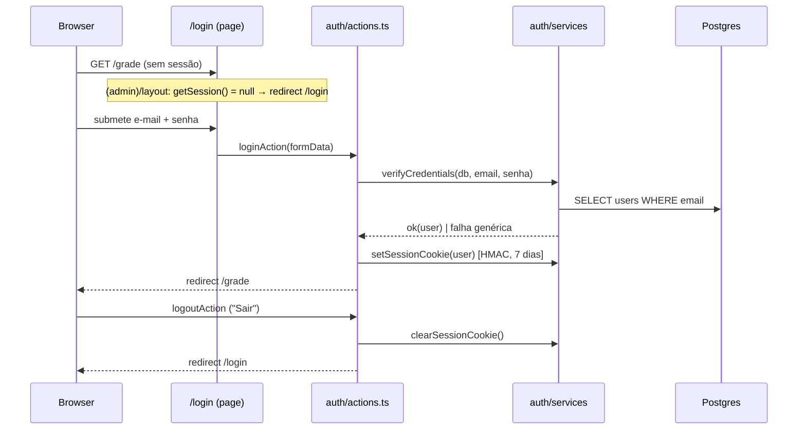

# Admin Base Design

**Spec**: `.specs/features/admin-base/spec.md`
**Status**: Draft

---

## Architecture Overview

Modular monolith (AD-004): novo módulo `src/modules/auth/`, módulo `plans` novo e
extensão do módulo `students`; o grupo `(admin)` ganha guard no layout e as
actions admin passam a exigir sessão. Login em rota própria `/login`, fora dos
route groups. Sem dependência nova: scrypt do `node:crypto` para senha e cookie
assinado com HMAC-SHA256 para sessão (defaults aprovados no spec).



Regras que mudam o que o usuário vê rodam em camada testável: validações de
formulário são funções puras em `domain/` + services testados contra Postgres
(Testcontainers); o que sobra na página é render.

---

## Code Reuse Analysis

### Existing Components to Leverage

| Component | Location | How to Use |
| --- | --- | --- |
| Padrão de actions finas sobre services | `src/modules/credits/actions.ts` | Mesma forma: action chama service, devolve ok/value ou error/field |
| Padrão de página admin + forms client | `src/app/(admin)/grade/page.tsx`, `grade/booking-forms.tsx` | Mesmo estilo para /planos e /alunos |
| Serviços de enrollment | `src/modules/students/services/enrollments.ts` | Detalhe do aluno lista horários fixos ativos |
| Serviços de crédito | `src/modules/credits/services/credits.ts` (`listStudentCredits`) | Detalhe do aluno lista créditos com vencimento |
| Composição de ocorrência | `src/modules/bookings/services/composition.ts` | T9 acrescenta o filtro do status do aluno |
| Convenções de teste | `src/test/fixtures.ts`, `*.test.ts` unit, `*.int.test.ts` integration | Mesma suíte Vitest + Testcontainers |
| Seed idempotente | `src/db/seed.ts` | Estende para o admin e para os novos campos de aluno |

### Integration Points

| System | Integration Method |
| --- | --- |
| `(admin)` route group | Guard no `layout.tsx` + `requireAdminSession()` nas actions |
| Tabelas existentes | `students` alterada in place; `plans` referenciada por `students.plan_id` |
| `db:seed` / `.env.local` | `ADMIN_EMAIL`, `ADMIN_PASSWORD`, `AUTH_SECRET` (documentados no `.env.example` e README) |
| `adminLabel` (AD-016) | Passa a vir da sessão no lugar do rótulo fixo "admin" |

---

## Components

### auth/domain/password.ts

- **Purpose**: hash e verificação de senha com scrypt + salt aleatório.
- **Location**: `src/modules/auth/domain/password.ts`
- **Interfaces**:
  - `hashPassword(password: string): string` - formato `scrypt:<salt>:<hash>`, hex
  - `verifyPassword(password: string, stored: string): boolean` - `timingSafeEqual`
- **Dependencies**: `node:crypto` (sem dependência externa)
- **Reuses**: nada (primeiro domínio de auth)

### auth/domain/session-token.ts

- **Purpose**: token de sessão stateless assinado (HMAC-SHA256, base64url).
- **Location**: `src/modules/auth/domain/session-token.ts`
- **Interfaces**:
  - `signSessionToken(payload: SessionPayload, secret: string, nowMs: number): string`
  - `verifySessionToken(token: string, secret: string, nowMs: number): { ok: true; payload } | { ok: false; reason: "tampered" | "expired" }`
- **Dependencies**: `node:crypto`
- **Reuses**: nada

### auth/services/session.ts

- **Purpose**: ler/escrever o cookie de sessão e o guard de admin.
- **Location**: `src/modules/auth/services/session.ts`
- **Interfaces**:
  - `getSession(): Promise<SessionUser | null>` - cookie `yoguese_session`, 7 dias, httpOnly, sameSite lax, secure em produção
  - `requireAdminSession(): Promise<SessionUser>` - `redirect("/login")` quando não há sessão ADMIN
  - `setSessionCookie(user)` / `clearSessionCookie()`
- **Dependencies**: `next/headers` (`await cookies()`), `AUTH_SECRET` do ambiente
- **Reuses**: `session-token.ts`

### auth/services/credentials.ts

- **Purpose**: autenticar por e-mail + senha com falha genérica (AUTH-03).
- **Location**: `src/modules/auth/services/credentials.ts`
- **Interfaces**:
  - `verifyCredentials(db, { email, password }): Promise<{ ok: true; user } | { ok: false }>` - normaliza e-mail (trim + lowercase); e-mail desconhecido e senha errada falham igual
- **Dependencies**: `users` (T1), `password.ts`
- **Reuses**: padrão de retorno `{ ok, value } | { error }` dos services existentes

### auth/actions.ts

- **Purpose**: server actions de login e logout.
- **Location**: `src/modules/auth/actions.ts`
- **Interfaces**:
  - `loginAction(prevState, formData)` - valida campos vazios/formato no servidor (AUTH-04), autentica, grava cookie e `redirect("/grade")`
  - `logoutAction()` - limpa o cookie e `redirect("/login")`
- **Dependencies**: `session.ts`, `credentials.ts`
- **Reuses**: padrão "use server" das actions existentes

### Módulo plans

- **Purpose**: CRUD de planos + regra do seletor (PLAN-04/05).
- **Location**: `src/modules/plans/` (`domain/validators.ts`, `services/plans.ts`, `actions.ts`)
- **Interfaces**:
  - `createPlan(db, input)` / `updatePlan(db, { planId, ... })` - valida nome, `price > 0`, `weeklyFrequency >= 1`
  - `listPlans(db)` - todos, ordenados por nome
  - `listSelectablePlans(db, currentPlanId?)` - ATIVO + o plano atual mesmo inativo (edição)
- **Dependencies**: tabela `plans` (T1), `requireAdminSession`
- **Reuses**: padrão de validators puros de `classes/domain/validators.ts`

### Módulo students (extensão)

- **Purpose**: cadastro completo do PRD 4.4, status de 4 valores e perfil agregado.
- **Location**: `src/modules/students/` (`domain/validators.ts` novo, `services/students.ts` estendido)
- **Interfaces**:
  - `createStudent(db, input)` / `updateStudent(db, { studentId, ... })` - campos obrigatórios; plano obrigatório quando status ATIVO; e-mail único com erro amigável
  - `setStudentStatus(db, { studentId, status })`
  - `listStudents(db)` - com nome do plano
  - `getStudentProfile(db, studentId)` - cadastro + plano + horários fixos ativos + créditos disponíveis com vencimento + histórico de reservas (STUD-08)
- **Dependencies**: tabelas `students`/`plans`/`users`, services de `enrollments`, `credits` e `bookings`
- **Reuses**: `enrollments.ts`, `listStudentCredits`, query de reservas por aluno (nova, no módulo bookings)

### Guard nas actions existentes

- **Purpose**: exigir sessão nas actions de `credits` e `classes`; `adminLabel` da sessão.
- **Location**: `src/modules/credits/actions.ts`, `src/modules/classes/actions.ts` (modify)
- **Interfaces**: cada action começa com `const session = await requireAdminSession()`
- **Dependencies**: `auth/services/session.ts`
- **Reuses**: helper de teste `src/test/auth.ts` mockando `next/headers` para a suíte

### Shell do (admin)

- **Purpose**: guard + navegação + identificação + Sair.
- **Location**: `src/app/(admin)/layout.tsx` (modify)
- **Interfaces**: server component; nav para Grade, Alunos, Planos, Créditos, Feriados
- **Dependencies**: `auth/services/session.ts`, `logoutAction`
- **Reuses**: header existente com a paleta do projeto

---

## Data Models

### users (nova)

```typescript
export const userRoleEnum = pgEnum("role_usuario", ["ADMIN", "ALUNO"]);
export const users = pgTable("users", {
  id: uuid("id").primaryKey().defaultRandom(),
  name: text("name").notNull(),
  email: text("email").notNull().unique(),
  passwordHash: text("password_hash").notNull(),
  role: userRoleEnum("role").notNull().default("ALUNO"),
  createdAt: timestamp("created_at", { withTimezone: true }).notNull().defaultNow(),
  updatedAt: timestamp("updated_at", { withTimezone: true }).notNull().defaultNow(),
});
```

### plans (nova)

```typescript
export const planStatusEnum = pgEnum("status_plano", ["ATIVO", "INATIVO"]);
export const plans = pgTable("plans", {
  id: uuid("id").primaryKey().defaultRandom(),
  name: text("name").notNull().unique(),
  price: numeric("price", { precision: 10, scale: 2 }).notNull(),
  weeklyFrequency: integer("weekly_frequency").notNull(),
  description: text("description"),
  status: planStatusEnum("status").notNull().default("ATIVO"),
  createdAt: timestamp("created_at", { withTimezone: true }).notNull().defaultNow(),
  updatedAt: timestamp("updated_at", { withTimezone: true }).notNull().defaultNow(),
});
```

### students (alterada in place)

- `phone` text not null; `email` text not null unique; `birth_date` date not null;
  `enrollment_date` date not null default CURRENT_DATE; `plan_id` uuid → plans
  (nullable); `notes` text (nullable); `user_id` uuid → users (nullable, prepara a
  área do aluno sem migração futura).
- Enum `status_aluno` ganha `EXPERIMENTAL` e `AGUARDANDO_MATRICULA` (PG 17 aceita
  ADD VALUE em transação).
- `name` deixa de ser UNIQUE (e-mail vira o identificador).

**Relationships**: `students.plan_id → plans.id`; `students.user_id → users.id`
(futura área do aluno); créditos, matrículas e reservas continuam ancorados em
`students.id`.

---

## Error Handling Strategy

| Error Scenario | Handling | User Impact |
| --- | --- | --- |
| Login com e-mail ou senha errados | Falha genérica única no service | "E-mail ou senha inválidos", sem sessão |
| Campo vazio/formato inválido no login ou cadastros | Validação server-side com erro por campo | Mensagem junto ao campo, dado não persiste |
| E-mail de aluno duplicado | Pré-checagem + constraint única | "E-mail já cadastrado" |
| Acesso a rota/action sem sessão | `redirect("/login")` no layout; `requireAdminSession()` nas actions | Tela de login |
| Sessão expirada (7 dias) | `verifySessionToken` devolve `expired` → tratada como sem sessão | Redirect ao login na próxima requisição |
| Plano inativo em formulário de aluno | `listSelectablePlans` omite; aluno existente mantém o plano | Seletor sem o plano inativo; detalhe segue mostrando-o |

---

## Risks & Concerns

| Concern | Location (file:line) | Impact | Mitigation |
| --- | --- | --- | --- |
| `createStudents` do fixtures insere só `name` - quebra com os novos NOT NULL | `src/test/fixtures.ts:54` | Suíte integração vermelha após T1 | T1 atualiza o fixtures (e-mails únicos com sufixo) no mesmo commit |
| `clearTables` não conhece `users`/`plans` | `src/test/fixtures.ts:12` | Truncates falham por FK | T1 acrescenta as tabelas novas ao truncate |
| Testes de action chamam actions direto - `requireAdminSession()` leria cookie real | `src/modules/credits/actions.ts`, `src/modules/classes/actions.ts` | Suíte quebra ao ligar o guard | Helper `src/test/auth.ts` com `vi.mock("next/headers")` + `AUTH_SECRET` de teste; T10 aplica aos dois arquivos de teste |
| Seed conflita por `students.name`, que deixa de ser único | `src/db/seed.ts:27` | Seed quebra | T1 muda o conflito para `email` e povoa os novos campos |
| Enum ADD VALUE dentro da migração | migration gerada | Falha se o Postgres for < 12 | PG 17 local e Testcontainers - risco baixo; conferir o SQL gerado pelo drizzle-kit em T1 |
| `cookies()` do Next 15 é async e só existe em contexto de request | `auth/services/session.ts` | Teste unit não pode ler cookie real | Token e senha são puros (unit); cookie testado via mock nas int e no walk no navegador |

---

## Tech Decisions (only non-obvious ones)

| Decision | Choice | Rationale |
| --- | --- | --- |
| Auth própria vs Auth.js | Própria (scrypt + cookie HMAC) | Default aprovado no spec: sem dependência nova pesada; 1 admin na v1; padrão reutilizável pela área do aluno |
| Sessão stateless vs tabela de sessões | Cookie assinado (stateless) | Sem query por request; revogação server-side antes da expiração fica para quando houver conta de aluno |
| Onde vive o guard | Layout do `(admin)` + `requireAdminSession()` em toda action admin | Server action é endpoint POST alcançável sem a página - defesa no servidor (PRD 13.6/13.3) |
| `/login` fora dos route groups | `src/app/login/page.tsx` | Guard do `(admin)` não deve redirecionar a própria tela de login |
| `students.user_id` agora | Coluna nullable já na migração | Evita nova migração de students na feature da área do aluno (PRD 12) |
| Preço como `numeric(10,2)` | String no drizzle, validação `> 0` no domínio | Dinheiro não vai em float |

**Project-level:** a escolha da stack de auth (AD-035 em `.specs/STATE.md`) vale
para a futura área do aluno - hash, formato de cookie e `AUTH_SECRET` são a
convenção da plataforma.
