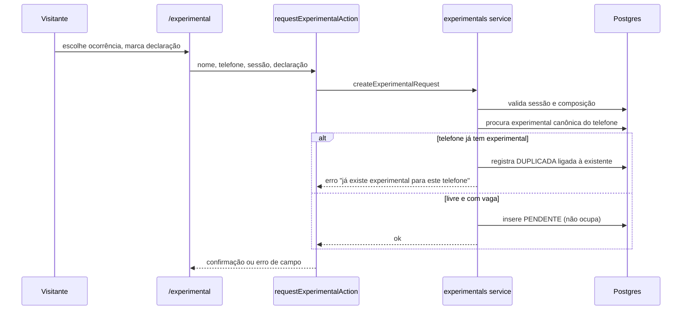
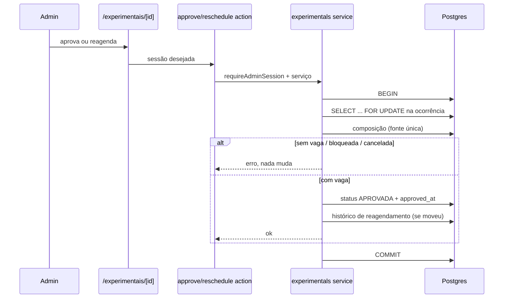

# Core Experimentais Design

**Spec**: `.specs/features/core-experimentais/spec.md`
**Status**: Draft

---

## Architecture Overview

A feature é um módulo novo (`src/modules/experimentals/`) com domínio puro,
serviços transacionais e actions finas; as telas ficam nos route groups já
existentes. A decisão de arquitetura de alto nível já foi fechada pelo usuário
na discussão (AD-036 a AD-040): tabela `EXPERIMENTALS` própria, aprovada
contando na composição, conversão criando aluna ativa, duplicidade por telefone
normalizado e formulário escolhendo ocorrência concreta. Não há outra abordagem
em disputa; o que segue detalha essa escolha.

- **Solicitação pública**: a página `(site)/experimental` lê as ocorrências
  futuras com vaga pelo serviço; o formulário cliente chama uma action pública
  (sem sessão) que revalida tudo no servidor.
- **Aprovação e gestão**: as actions administrativas exigem
  `requireAdminSession()` e chamam serviços transacionais; toda checagem de
  vaga usa `getOccurrenceComposition` como fonte única (RES-27).
- **Ocupação**: `getOccurrenceComposition` soma as experimentais `APROVADA`
  ao lado dos fixos, reposições e reservas `EXPERIMENTAL` já existentes.
- **Cancelamentos do estúdio**: os dois caminhos existentes (cancelamento de
  ocorrência e bloqueio por feriado/recesso) chamam um helper que transforma
  `PENDENTE`/`APROVADA` em `CANCELADA_COM_DIREITO` (AD-039).
- **Conversão**: um serviço transacional cria aluna, matrículas fixas e
  atualiza a experimental; nada é gravado parcialmente.





---

## Code Reuse Analysis

### Existing Components to Leverage

| Component | Location | How to Use |
| --- | --- | --- |
| Materialização get-or-create da ocorrência | `src/modules/bookings/services/sessions.ts` | Reutilizar `materializeSession` para a ocorrência escolhida |
| Composição da ocorrência (fonte única) | `src/modules/bookings/services/composition.ts` | Estender para contar experimentais aprovadas |
| Matemática de datas do estúdio | `src/modules/classes/domain/occurrences.ts` | Reutilizar `todayInStudio`, `addDays`, `nextOccurrence`, `weekdayOf`; acrescentar `studioDateTimeToInstant` |
| Guard de sessão admin | `src/modules/auth/services/session.ts` | `requireAdminSession` em toda action administrativa |
| Normalização de e-mail e helpers de aluna | `src/modules/students/services/students.ts` | Exportar/reutilizar `emailTaken`, `planExists`, `isUniqueViolation` e `normalizeEmail` na conversão |
| Validador de aluna | `src/modules/students/domain/validators.ts` | Reutilizar `validateStudent` no cadastro criado pela conversão |
| Planos selecionáveis | `src/modules/plans/services/plans.ts` | `listSelectablePlans` para o formulário de conversão |
| Turmas ativas | `src/modules/classes/services/classes.ts` | `listActiveSlots` para a agenda da experimental |
| Cancelamento pelo estúdio | `src/modules/credits/services/cancellations.ts` | Hook para cancelar experimentais da ocorrência |
| Bloqueio por feriado/recesso | `src/modules/bookings/services/blocks.ts` | Hook para cancelar experimentais da ocorrência bloqueada |
| Grade do admin | `src/app/(admin)/grade/page.tsx` | Listar as experimentais aprovadas como participantes |
| Formulários admin | `src/app/(admin)/alunos/student-forms.tsx` | Padrão `useActionState` + `router.refresh()` + feedback |
| Fixtures de teste | `src/test/fixtures.ts` | `clearTables` precisa truncar as tabelas novas; criar helper de experimental |

### Integration Points

| System | Integration Method |
| --- | --- |
| Postgres | Novas tabelas `experimentals` e `experimental_reschedules`; colunas de declaração em `students`; migração Drizzle |
| Composição existente | `getOccurrenceComposition` consulta `experimentals` com status `APROVADA` |
| Agenda pública | Já usa a composição; passa a descontar a experimental aprovada sem mudar o shape |
| Grade admin | Leitura de aprovadas por sessão + exibição na lista de participantes |
| Cancelamento do estúdio | Helper chamado por `cancelOccurrenceByStudio` e por `applyBlockTransition` |
| Auth | Actions públicas sem guard; actions admin com `requireAdminSession` |

---

## Components

### Schema e migração

- **Purpose**: Guardar solicitações, tentativas, histórico de reagendamento e a
  declaração de saúde da aluna convertida.
- **Location**: `src/db/schema/experimentals.ts`, `src/db/schema/students.ts`,
  `src/db/schema/index.ts`, `drizzle/0003_*.sql`
- **Interfaces**: tabelas `experimentals`, `experimentalReschedules`; enums
  `status_experimental`, `status_pagamento_experimental`; colunas
  `healthDeclaration`, `healthDeclarationAcceptedAt` em `students`.
- **Dependencies**: `class_sessions`, `students`.
- **Reuses**: convenções de `src/db/schema/sessions.ts` (enums pg, timestamps,
  índice parcial único).

### Domínio de telefone

- **Purpose**: Normalizar e validar o telefone usado como identidade da
  experimental (PRD 8.2, EXP-10).
- **Location**: `src/modules/experimentals/domain/phone.ts`
- **Interfaces**:
  - `normalizePhone(raw: string): string` - remove não dígitos e o código `55`
  - `isValidPhone(normalized: string): boolean` - aceita 10 ou 11 dígitos
- **Dependencies**: nenhuma.
- **Reuses**: estilo puro de `src/modules/credits/domain/credit-week.ts`.

### Domínio de regras e textos

- **Purpose**: Validar a solicitação e a conversão e carregar os termos fixos
  do PRD (declaração, preço, status) e a regra de 24 horas.
- **Location**: `src/modules/experimentals/domain/validators.ts`,
  `src/modules/experimentals/domain/rules.ts`
- **Interfaces**:
  - `HEALTH_DECLARATION`, `EXPERIMENTAL_PRICE_CENTS`
  - `validateExperimentalRequest(input)`
  - `validateConversion(input)`
  - `cancellationKeepsRight(hoursBeforeStart: number): boolean`
  - `isTerminalStatus(status)`, `canCancel(status)`, `canReschedule(status)`,
    `canConvert(status)`
  - `EXPERIMENTAL_STATUS_LABELS`, `PAYMENT_STATUS_LABELS`
- **Dependencies**: enums do schema e `validateStudent` para o cadastro.
- **Reuses**: `validateStudent`, `isValidDate` e o padrão de erro por campo de
  `students/domain/validators.ts`.

### Janela de 24 horas

- **Purpose**: Converter data + horário do estúdio em instante absoluto para a
  regra de 24h e para saber se a aula terminou (conversão).
- **Location**: `src/modules/classes/domain/occurrences.ts`
- **Interfaces**:
  - `studioDateTimeToInstant(date: string, time: string): Date`
- **Dependencies**: `STUDIO_TIMEZONE`.
- **Reuses**: `todayInStudio` e o formato de data do módulo.

### Serviço de solicitação

- **Purpose**: Criar a solicitação pública, bloquear duplicidade e registrar a
  tentativa duplicada (EXP-06 a EXP-16).
- **Location**: `src/modules/experimentals/services/experimentals.ts`
- **Interfaces**:
  - `createExperimentalRequest(db, input, now?): Promise<ExperimentalResult>`
  - `listExperimentalOccurrences(db, input, now?): Promise<OccurrenceOption[]>`
- **Dependencies**: `materializeSession`, `getOccurrenceComposition`,
  `listActiveSlots`, `occurrenceDates`, `normalizePhone`.
- **Reuses**: composição e materialização existentes.

### Serviço de aprovação e gestão

- **Purpose**: Aprovar, recusar, trocar data/horário, reagendar, registrar
  pagamento, contato, cancelamento e falta, e ler as solicitações.
- **Location**: `src/modules/experimentals/services/experimentals.ts`
- **Interfaces**:
  - `approveExperimental`, `refuseExperimental`
  - `changeExperimentalOccurrence`, `rescheduleExperimental`
  - `cancelExperimental`, `registerNoShow`
  - `registerPayment`, `registerWhatsAppContact`
  - `listExperimentals`, `getExperimental`
- **Dependencies**: `getOccurrenceComposition`, `studioDateTimeToInstant`,
  `experimentalReschedules`.
- **Reuses**: padrão de transação e `SELECT ... FOR UPDATE` de `createBooking`.

### Serviço de conversão

- **Purpose**: Criar a aluna ativa com plano, horários fixos e declaração
  copiada, tudo ou nada (EXP-50 a EXP-61).
- **Location**: `src/modules/experimentals/services/conversion.ts`
- **Interfaces**:
  - `convertExperimental(db, input, now?): Promise<ConversionResult>`
- **Dependencies**: `validateStudent`, `normalizeEmail`, `emailTaken`,
  `planExists`, `getOccurrenceComposition`, `nextOccurrence`.
- **Reuses**: validador e helpers de aluna; transação única.

### Helper de cancelamento por ocorrência

- **Purpose**: Cancelar experimentais pendentes/aprovadas quando a ocorrência
  deixa de acontecer, mantendo o direito (EXP-45).
- **Location**: `src/modules/experimentals/services/cancellations.ts`
- **Interfaces**:
  - `cancelExperimentalsForOccurrence(tx, sessionId, now): Promise<number>`
- **Dependencies**: apenas schema `experimentals`.
- **Reuses**: chamado por `cancelOccurrenceByStudio` e por
  `applyBlockTransition`.

### Actions

- **Purpose**: Ponte fina entre as telas e os serviços.
- **Location**: `src/modules/experimentals/actions.ts`
- **Interfaces**:
  - pública: `requestExperimentalAction(input)`
  - admin: `approveExperimentalAction`, `refuseExperimentalAction`,
    `changeExperimentalOccurrenceAction`, `rescheduleExperimentalAction`,
    `cancelExperimentalAction`, `registerNoShowAction`,
    `registerPaymentAction`, `registerWhatsAppContactAction`,
    `convertExperimentalAction`
- **Dependencies**: `requireAdminSession` nas administrativas; `db` dinâmico.
- **Reuses**: padrão de `src/modules/classes/actions.ts`.

### Telas

- **Purpose**: Formulário público e painel administrativo.
- **Location**: `src/app/(site)/experimental/`,
  `src/app/(admin)/experimentais/`, `src/app/(site)/page.tsx`,
  `src/app/(admin)/layout.tsx`.
- **Interfaces**: páginas server components + formulários cliente com
  `useActionState`, `confirm()` nas ações destrutivas e `router.refresh()`.
- **Dependencies**: services e actions acima.
- **Reuses**: classes CSS e padrão visual de `alunos`/`feriados`/`grade`.

---

## Data Models

### Experimental

```typescript
type ExperimentalStatus =
  | "PENDENTE"
  | "APROVADA"
  | "RECUSADA"
  | "CANCELADA_COM_DIREITO"
  | "CANCELADA_SEM_DIREITO"
  | "FALTA"
  | "CONVERTIDA"
  | "DUPLICADA";

type ExperimentalPaymentStatus = "PENDENTE" | "PAGO" | "ISENTO" | "REEMBOLSADO";

interface Experimental {
  id: string;
  name: string;
  phone: string;                 // como digitado
  phoneNormalized: string;       // identidade de duplicidade
  classSessionId: string;
  status: ExperimentalStatus;
  paymentStatus: ExperimentalPaymentStatus;
  healthDeclaration: string;
  duplicateOfId: string | null;  // preenchido nas tentativas DUPLICADA
  requestedAt: Date;
  approvedAt: Date | null;
  cancelledAt: Date | null;
  noShowAt: Date | null;
  attendedAt: Date | null;
  whatsappContactedAt: Date | null;
  convertedStudentId: string | null;
  createdAt: Date;
  updatedAt: Date;
}
```

**Constraints**:

- Índice único parcial `experimentals_telefone_unico` em `phone_normalized`
  WHERE `status <> 'RECUSADA' AND duplicate_of_id IS NULL` (AD-038): garante
  uma solicitação canônica por telefone mesmo em corrida; tentativas
  `DUPLICADA` e recusadas ficam fora do índice.
- `duplicate_of_id` referencia `experimentals.id`; `converted_student_id`
  referencia `students.id`; `class_session_id` referencia `class_sessions.id`.
- A checagem de duplicidade do serviço ignora `duplicate_of_id IS NOT NULL`
  (tentativa não é solicitação) e status `RECUSADA` (EXP-48).

### ExperimentalReschedule

```typescript
interface ExperimentalReschedule {
  id: string;
  experimentalId: string;
  fromSessionId: string;
  toSessionId: string;
  reason: string;
  rescheduledAt: Date;
}
```

**Relationships**: cada reagendamento/troca de ocorrência guarda a ocorrência
anterior (PRD 8.5 "registrar cancelamento da reserva anterior"); a experimental
aponta para a ocorrência atual.

### Students (adição)

```typescript
interface StudentHealth {
  healthDeclaration: string | null;
  healthDeclarationAcceptedAt: Date | null;
}
```

**Relationships**: preenchidos na conversão com o texto e o `requested_at` da
experimental; os demais cadastros ficam nulos.

---

## Error Handling Strategy

| Error Scenario | Handling | User Impact |
| --- | --- | --- |
| Telefone inválido/vazio | Validador de domínio devolve erro por campo | Mensagem "Telefone inválido" no formulário |
| Telefone já tem experimental | Serviço grava `DUPLICADA` e devolve erro de campo | "Já existe uma aula experimental para este telefone" |
| Ocorrência passada/bloqueada/cancelada/sem vaga na solicitação | Serviço revalida e recusa | Erro claro e formulário preservado |
| Aprovação sem vaga | Transação recusa, status fica `PENDENTE` | Admin vê o erro e escolhe outro horário |
| Duas aprovações na última vaga | `SELECT ... FOR UPDATE` serializa; uma confirma | A segunda recebe "sem vaga" |
| Duas submissões do mesmo telefone | Índice único parcial; a perdedora vira `DUPLICADA` | Uma confirmação, um bloqueio |
| Cancelamento depois do início | Serviço recusa | Admin é orientado a registrar falta |
| Falta antes do início | Serviço recusa | Erro claro |
| Reagendamento sem vaga | Transação recusa e mantém o direito | Status anterior preservado |
| Conversão com horário lotado | Transação recusa nomeando o horário | Nada é criado |
| Conversão antes do fim da aula | Serviço recusa | "Experimental ainda não realizada" |
| E-mail duplicado na conversão | `emailTaken` + unique violation | Erro no campo e-mail |
| Plano inexistente/inativo | Serviço recusa com erro de campo | Erro no campo plano |
| Action admin sem sessão | `requireAdminSession` redireciona ao login | Sem acesso |

---

## Risks & Concerns

| Concern | Location (file:line) | Impact | Mitigation |
| --- | --- | --- | --- |
| N+1 na leitura de 30 dias × turmas da agenda pública | `src/app/(site)/api/agenda/route.ts:56` (precedente) | Formulário público lento com muitas turmas | Janela de 30 dias e poucas turmas; reutiliza a composição; sem otimização extra nesta feature |
| Regra de 24h precisa de instante absoluto, não de string | `src/modules/classes/domain/occurrences.ts:14` | Cálculo errado se o servidor roda em UTC | `studioDateTimeToInstant` com offset do fuso + testes nas bordas 24h/23h59 |
| Índice único parcial com auto-referência | `src/db/schema/experimentals.ts` (novo) | Migração/consulta de corrida quebrada | Teste de schema + teste de concorrência da solicitação (L-015) |
| Boundary de auth na action pública | `src/modules/experimentals/actions.ts` (novo) | Expor action admin sem sessão | Arquivo separa claramente; teste de guard para cada action admin |
| Composição com duas fontes de experimental (booking + tabela) | `src/modules/bookings/services/composition.ts:74` | Contagem dupla ou vaga errada | Só `APROVADA` da tabela soma; `CONVERTIDA` não conta; teste de composição |
| Conversão pode gravar aluna sem matrícula | `src/modules/experimentals/services/conversion.ts` (novo) | Cadastro órfão se o segundo horário falhar | Uma transação com todas as matrículas; teste de rollback |
| Página da grade já é grande | `src/app/(admin)/grade/page.tsx:137` | Difícil testar a listagem de experimentais | Serviço `listApprovedExperimentalsBySession` testado; página só renderiza |
| Isolamento de testes | `src/test/fixtures.ts:10` | Dados de experimental vazam entre suites | `clearTables` inclui as tabelas novas; helper de fixture |
| FK auto-referência no Drizzle | `src/db/schema/experimentals.ts` (novo) | Erro de tipo na migração | Usar `AnyPgColumn` como tipo de retorno da referência |

---

## Tech Decisions (only non-obvious ones)

| Decision | Choice | Rationale |
| --- | --- | --- |
| Modelo de histórico de reagendamento | Tabela `experimental_reschedules` | O PRD 8.5 exige registrar a reserva anterior; um único `previous_session_id` perderia o segundo reagendamento |
| Unicidade por telefone | Índice único parcial + filtro no serviço | Fecha a corrida sem impedir a tentativa `DUPLICADA` nem a nova solicitação após `RECUSADA` |
| Identidade da tentativa | `duplicate_of_id` na própria tabela | Evita uma tabela só para tentativas bloqueadas e mantém tudo consultável |
| Contagem na composição | Ler `experimentals` no mesmo ponto da composição | Fonte única (RES-27); a agenda e a grade não recalculam |
| Presença | Conversão grava `attended_at` | PRD 8.6 parte da experimental realizada; sem ação separada (assumption) |
| Cancelamento pelo estúdio | Helper compartilhado nos dois caminhos | Evita divergência entre cancelamento de ocorrência e bloqueio |
| Preço | Constante de domínio `EXPERIMENTAL_PRICE_CENTS = 4500` | PRD 8.4 fixa o valor inicial e não pede configuração |
| Declaração | Constante de domínio gravada no servidor | O cliente não pode alterar o texto aceito |
| Normalização de telefone | Dígitos + remoção de `55` | PRD 8.2; formato brasileiro (10/11 dígitos) |
